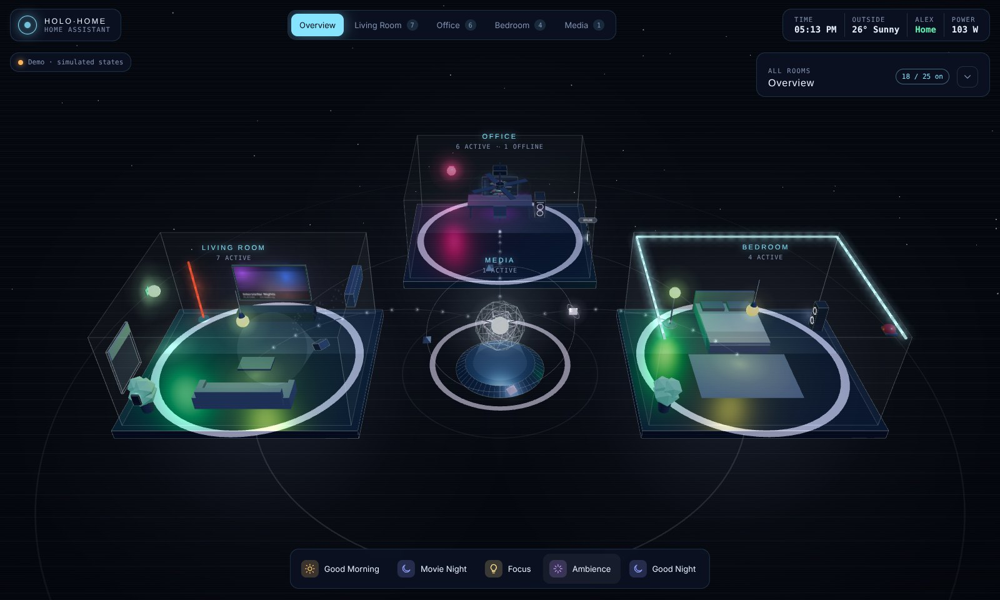
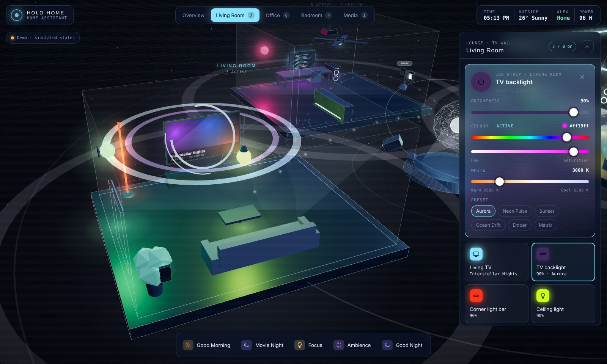
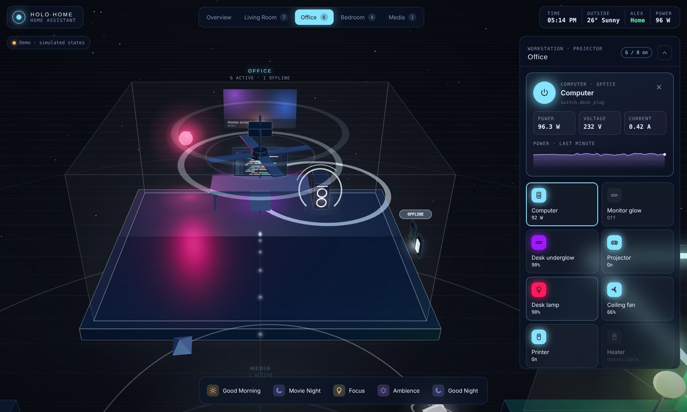
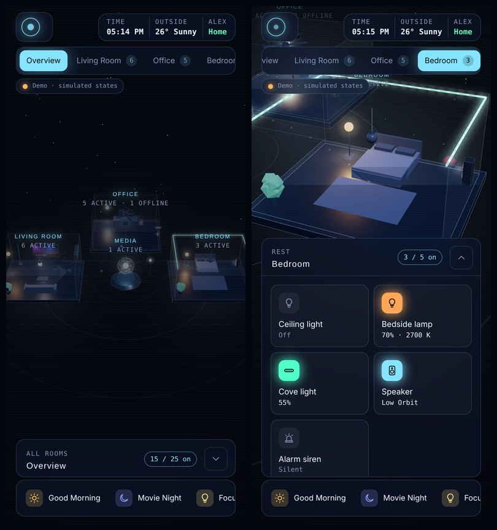

# Holo Home

**A 3D holographic dashboard for Home Assistant.** Your rooms float around a glowing core: lights glow and cast colour on the floor, TVs show what's playing, the AC blows, the fan spins, and LED strips run their effects. Tap a light to switch it, or tap anything else to open its controls.

You don't write any code. You describe your home in one small file, `config.js`, and Claude (the free plan is enough) can write that file for you from your existing dashboard YAML.

**Try it first:** download this repo and open `www/holo-home/index.html` in your browser. It runs the example home in demo mode, and nothing needs installing.



| Room view with full colour and white controls | Workstation with live power readings and a projector |
|---|---|
|  |  |

<p align="center"></p>

## What it does

- **Every room in 3D.** Bulbs, LED strips, TVs, projectors, computers, switches, cameras, sirens, ceiling fans, ACs, speakers, blinds and locks all sit where they are in your real room.
- **Simple touch rules.** Tapping a light switches it on or off. Tapping a TV, PC, AC, fan or any other appliance only selects it and opens its controls, so you never switch something off by accident.
- **Full light control.** Brightness, a hue and saturation slider covering 16 million colours, a white-temperature slider in kelvin, and WLED presets or effects. Only the controls each light supports are shown.
- **Media.** Artwork from Home Assistant appears on the 3D TV screen, along with play/pause, skip and volume. Music players orbit the core and pulse while they play.
- **Ambilight look.** A `sync` backlight glows with the colours at the edges of the screen.
- **Scenes.** One tap in the bottom dock sends a shockwave through the room it controls.
- **Shows what's offline.** Unavailable devices turn grey with an OFFLINE tag, and a whole room greys out if everything in it is down.
- **Stays out of the way.** The control panel is minimised on the overview and opens when you pick a room or a device. It becomes a bottom sheet on phones.
- **No tokens or add-ons.** Opened from a Home Assistant dashboard, it uses the session you're already logged in with. Opened anywhere else, it runs a demo.

## Make your own (about 10 minutes)

### 1. Download the files

Click **Code → Download ZIP** on this page and unzip it. You only need the `www/holo-home` folder:

```
holo-home/
├── index.html      the engine (don't edit)
├── three.min.js    3D library (three.js r128, MIT)
└── config.js       YOUR home (you'll replace this)
```

### 2. Copy your current dashboard

In Home Assistant, open the dashboard that has your devices, then click the **pencil (Edit dashboard)** → **⋮** → **Raw configuration editor**. Select everything and copy it.

> If it says the dashboard is auto-generated, choose **Take control** first. You can also just paste a list of entity IDs from **Settings → Devices & services → Entities**.

### 3. Ask Claude to write your `config.js`

Open [claude.ai](https://claude.ai) (the free plan works) and send one message containing:

1. The whole of [`PROMPT.md`](PROMPT.md). Paste it in, or attach the file.
2. Your dashboard YAML from step 2.
3. Optionally, where things are. For example:
   > Bulb 2 is on the wall above the TV, bulb 1 is on the right wall, bulb 3 is on the wall opposite the TV. The 5 ft light bar stands to the left of the TV. In the setup room the Fire TV runs a projector that shines on the wall above the monitor.

Claude replies with a complete `config.js`. Save it as `config.js`, replacing the example one in the `holo-home` folder.

> Anything you don't describe is placed automatically, so you can skip the layout notes and fix positions later.

### 4. Put the folder in Home Assistant

Copy the whole `holo-home` folder into your Home Assistant config's `www` folder, so you end up with:

```
/config/www/holo-home/index.html
/config/www/holo-home/three.min.js
/config/www/holo-home/config.js
```

The easiest ways are the **File editor** or **Studio Code Server** add-on, or the **Samba share** add-on from your computer.

> If the `www` folder didn't exist before, **restart Home Assistant** once so it starts serving it.

### 5. Check it loads

Open `http://<your-ha-address>:8123/local/holo-home/index.html` in a browser. You should see your rooms with an orange **Demo** chip in the corner. That's expected, because the page only goes live inside a dashboard.

### 6. Add it as a dashboard

**Settings → Dashboards → Add dashboard → Webpage**, then:

- **URL:** `/local/holo-home/index.html?v=1` (the relative path, not the full address)
- **Title / icon:** e.g. *Holo Home*, `mdi:cube-scan`
- Turn on **Show in sidebar**

Open it from the sidebar. The chip turns green and reads **Live · Home Assistant**, and every control now drives your real devices. It works the same in the Home Assistant phone app.

## Changing things later

Send Claude your current `config.js` plus what you want changed, for example *"move the AC to the left wall and add `light.balcony` to a new Balcony room"*. Save the file it sends back over the old one and reload the dashboard. `config.js` is never cached, so changes show up straight away.

If you replace `index.html` with a newer version, bump the dashboard URL to `?v=2`, `?v=3` and so on so the browser fetches it again.

## Supported devices

| Type | Entities | In 3D | Controls |
|---|---|---|---|
| `bulb` | `light.*` | wall lamp, ceiling pendant or floor lamp with a light pool | on/off, brightness, colour, white temperature |
| `strip` | `light.*` | screen frame, standing bar, wall line, ceiling cove, under-desk | the same, plus presets and effects |
| `tv` | `remote.*` / `media_player.*` | wall TV with artwork and console | power, play/pause, skip, volume |
| `projector` | `remote.*` / `media_player.*` | ceiling projector with beam and wall image | the same as a TV |
| `computer` | `switch.*` plug | desk, monitor, tower, chair | power, live W/V/A readouts and a sparkline |
| `switch` | `switch.*`, `input_boolean.*` | wall switch | on/off |
| `camera` | `camera.*` | camera with view cone | live snapshot, optional power switch |
| `siren` | `siren.*` | wall siren with rotating beam | sound / silence (two taps) |
| `fan` | `fan.*` | ceiling fan that spins at its speed | on/off, speed |
| `climate` | `climate.*` | wall AC with airflow and temperature display | on/off, target temperature, mode |
| `speaker` | `media_player.*` | floor speaker that pulses with music | play/pause, skip, volume |
| `device` | `cover.*`, `lock.*`, anything else | window with blind, keypad, or holo marker | open/close, lock/unlock, on/off |

The full list of options is in [`PROMPT.md`](PROMPT.md).

## Troubleshooting

| What you see | Fix |
|---|---|
| The chip stays orange inside Home Assistant | Your browser is sandboxing the page. Use a Webpage **card** instead: make a dashboard with a **Panel (single card)** view and add the card in the code block below. |
| "config.js has a problem" | The message names the line. It's usually a missing comma or quote. Paste the message and your `config.js` into Claude and ask it to fix the file. |
| "config.js wasn't found" | `config.js` must sit next to `index.html` in `/config/www/holo-home/`. |
| A tile says "Not found in HA" | That entity ID doesn't exist. Check it in **Settings → Entities** and correct it in `config.js`. |
| Old version still showing after an update | Change the dashboard URL to `?v=2` (then `?v=3`, …). |
| Slow on an old wall tablet | WebGL is heavy for very cheap tablets. Fewer rooms per dashboard helps. |

The Webpage card for the first row:

```yaml
type: iframe
url: /local/holo-home/index.html?v=1
aspect_ratio: 100%
disable_sandbox: true
```

> **Security note:** files in `/config/www` can be downloaded by anyone who can reach your Home Assistant, without logging in. Holo Home's files contain no passwords or tokens, only entity IDs. Keep it that way if you edit them.

## How it works

`index.html` is a single page built with [three.js](https://threejs.org). When Home Assistant shows it inside a dashboard, it runs on the same address as Home Assistant. That lets it read the live states from the frontend's `hass` object every second and call services through your existing session, so no long-lived token is stored anywhere. Outside Home Assistant it fills every entity with believable demo states, which is how the screenshots above were made.

## Credits

Made by [Krishna Asiwal](https://github.com/Krishna9827). 3D rendering by three.js (MIT). Fonts are Michroma, Sora and JetBrains Mono from Google Fonts.

Released under the [MIT licence](LICENSE).
